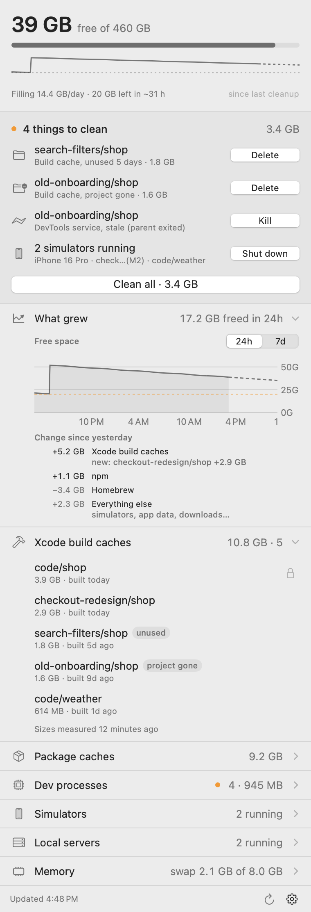

<p align="center"></p>

<h1 align="center">Lapang</h1>

A small macOS menu bar app that keeps an eye on what quietly fills up a developer's Mac (build caches, simulators, stray dev processes, swap) and lets you clear it in a click.

*Lapang* is Malay for spacious. *Rasa lapang* is the light feeling of having room to breathe again.

<p align="center"></p>

The menu bar shows free disk space (`41G`) and adds a warning sign when space is low or filling fast. The label is kept narrow on purpose: on a notched MacBook, menu bar items that don't fit are silently hidden. If that happens anyway, open Lapang from Spotlight or Finder and the same panel appears in a normal window. The panel shows:

- **Things to clean**: what's worth acting on right now, at the top: build caches whose project is gone or unused for days, stale processes, servers still running from a deleted folder, running simulators. Each has its own button, plus one "Clean all". Everything else folds into a single line until you open it.
- **Memory**: in the header next to disk: memory pressure, RAM used, swap, and a 24-hour pressure strip like Activity Monitor's ("under pressure 78% of the last 24 h"). "Memory users" lists the apps using the most memory by footprint, helpers included, with a Quit button for apps and Shut down for simulators.
- **Disk**: free space, a usage bar, a sparkline of the last 24 hours, and a full chart (24 hours or 7 days) under "What grew".
- **Trend**: how fast the disk is filling (a straight-line fit over the last 24 hours, restarting after any cleanup) and when it will reach your warning line, drawn as a dashed projection on the chart. A comparison with the size check from about a day ago shows what grew, e.g. `+4.2 GB Xcode build caches (mostly my-app +3.7 GB)`, with an "everything else" line for growth no measured folder explains. You get a notification when free space drops below your threshold, or when it's on course to within `forecastHours`.
- **Simulators**: booted iOS simulators and what each is for: the app running inside it, the project folder of the `flutter run` or `xcodebuild` driving it, and the app that launched that (your terminal, Xcode, Claude Code). A simulator still running an app from a deleted folder shows up under things to clean.
- **Dev processes**: watched processes (Dart and Flutter by default, including `flutter run`) with memory use and uptime. A process is marked stale when its parent died or its folder is gone.
- **Ports**: your servers listening on a TCP port: the port, what it is (Vite, Next.js, `php artisan serve`, postgres, redis…), the folder it was started in (the last two folders, so worktrees are told apart), uptime, memory, and whether it's reachable only from this Mac or from the network. Each row has an Open link and a Stop button. Stop sends SIGTERM only to the process that owns the listening socket, after checking it's still the same program. A program that just has a connection to the port, like a tunnel in front of your dev server, is never stopped by mistake. App helpers, system services, other users' processes and ports 49152 and up are left out. Docker and OrbStack port forwards are shown but not stopped.
- **Xcode build caches**: one row per DerivedData folder, mapped back to its project. Each shows size and when it was last built, and whether the project still exists. You can clean orphaned or unused caches in bulk; projects you mark as protected are never touched.
- **Package caches**: npm, Yarn, pnpm, CocoaPods, Gradle, Homebrew, pub, iOS DeviceSupport and Xcode archives, with a Clear button where clearing is safe.
- **Custom sections**: anything else, from your own scripts (see below).

Destructive buttons always ask first. Folder sizes are measured in the background every 30 minutes, because `du` on big caches is slow.

## Build and run

Requires macOS 14 or later and Xcode (or the Command Line Tools with Swift 5.10+).

```bash
git clone https://github.com/afiqsazlan/lapang.git && cd lapang
./build.sh
```

`build.sh` compiles a release build, installs `Lapang.app` into `~/Applications` and launches it. To have it start at login, tick **Open at login** in the panel's gear menu. Use `./build.sh --no-install` to only build `./build/Lapang.app`.

## Command line, and agents

The app binary is also a command. `build.sh` links it as `~/.local/bin/lapang` when that folder exists.

```bash
lapang status          # the panel as text
lapang status --json   # the same as JSON
lapang clean           # what would be cleaned; add --yes to do it (--only caches,processes,simulators,ports)
lapang ports           # servers listening on a port, with folder and uptime (--json too)
lapang stop-port 5173  # stop the server listening on 5173; add --yes to do it
lapang kill-old-mcp    # every MCP server but the newest; add --yes to do it
lapang quit "Figma"    # ask an app from Memory users to quit; add --yes to do it
lapang log             # what Lapang did: deleted, killed, shut down, and what it freed
```

Actions only print what they would do until you add `--yes`. That makes it safe to hand to a coding agent: a Claude Code session (including one you drive from your phone with Remote Control) can run `lapang status`, tell you what's going on, and run the action once you agree.

Every action that runs, from the panel or the command line, is written to `~/Library/Application Support/Lapang/actions.log`: one JSON line with the time, where it came from, exactly what was acted on (paths, pid, simulator udid, app bundle), the result, and the disk or memory it freed. Entries are kept for 30 days. Read it with `lapang log` (`--json`, `--limit N`) or under **Recent actions** in the gear menu. The log never leaves your Mac.

## Configuration

Gear menu → **Edit config…** opens `~/.config/lapang/config.json`, creating it if needed. Every key is optional, and changes apply on the next refresh.

```json
{
  "refreshSeconds": 60,
  "disk": { "warnGB": 20, "criticalGB": 10, "notify": true, "forecastHours": 24, "watch": ["~/Downloads"] },
  "xcode": {
    "idleDays": 3,
    "protect": ["~/code/my-app"]
  },
  "processes": { "names": ["dart", "dartvm", "dartaotruntime"] },
  "caches": { "hide": ["pnpm"] },
  "ports": { "minPort": 1024, "maxPort": 49151, "hide": [5000, "adb"], "names": { "3000": "tunnel origin" } },
  "sections": [
    { "title": "Servers", "icon": "server.rack", "command": "~/.config/lapang/sections/servers.sh" }
  ]
}
```

- `disk.forecastHours`: warn early when the fill rate says free space will reach `warnGB` within this many hours.
- `disk.watch`: extra folders to include in "what's growing". Xcode and package caches are always measured.
- `xcode.protect`: project folders whose build caches are never cleaned in bulk, usually your main checkouts. Rebuilding those from scratch is slow, while caches of throwaway worktrees aren't worth keeping.
- `processes.names`: executable names to watch.
- `ports.minPort`, `ports.maxPort`: the range of ports to show. 49152 and up is where macOS hands out temporary ports (debuggers, editor helpers), so it's left out by default.
- `ports.hide`: port numbers, or process names and kinds (`"adb"`, `"cloudflared"`, `"Vite"`), to leave out.
- `ports.names`: your own labels for ports, shown next to the row.
- `caches.hide`: cache ids to leave out. The ids are `npm`, `yarn`, `pnpm`, `cocoapods`, `gradle`, `homebrew`, `pub`, `devicesupport` and `archives`.

## Custom sections

A section is any executable. When run with no arguments, it prints JSON:

```json
{
  "badge": { "text": "All up", "tone": "good" },
  "rows": [
    {
      "title": "api",
      "subtitle": "~/code/api [main]",
      "icon": "server.rack",
      "tags": [{ "text": "dirty", "tone": "warn" }],
      "link": "https://api.localhost",
      "reveal": "~/code/api",
      "button": { "title": "Restart", "run": ["restart", "api"], "confirm": "Drops open connections." },
      "menu": { "title": "Switch", "items": [{ "title": "main", "checked": true, "run": ["switch", "main"] }] }
    },
    { "title": "notes", "icon": "doc", "group": "Docs", "reveal": "~/notes" }
  ]
}
```

- `tone` is one of `good`, `warn`, `bad` or `info`, or leave it out for neutral.
- `icon` is any SF Symbol name.
- `link` adds an open-in-browser button. `reveal` makes the row show that path in Finder when clicked.
- Rows that share a `group` fold into a disclosure list.
- `button` and menu `items` run the same executable with their `run` arguments. If `confirm` is set, Lapang asks first and then sets `LAPANG_CONFIRMED=1`. The first line the script prints is shown in the panel's status line.

The section runs on every refresh, so keep it fast (well under a second).

## Development

The app icon is drawn in code: `xcrun swift Support/make-icon.swift` regenerates `Support/AppIcon.icns` and `docs/icon.png`.

`Lapang --render out.png` draws the full panel off-screen with live data and exits. It's useful for checking layout without clicking around the menu bar. Add `--demo` to use built-in sample data, `--light` for the light appearance, and `--open "Simulators,Memory"` to show sections opened. The README screenshot is made with:

```bash
./build.sh --no-install && build/Lapang.app/Contents/MacOS/Lapang --render docs/screenshot.png --demo --light
```

## License

MIT, see [LICENSE](LICENSE).
