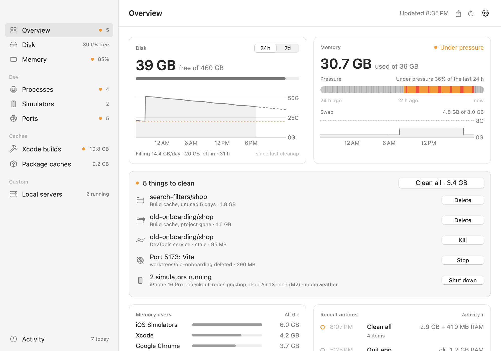

<p align="center"></p>

<h1 align="center">Lapang</h1>

A small macOS menu bar app that keeps an eye on what quietly fills up a developer's Mac (build caches, simulators, stray dev processes, swap) and lets you clear it in a click.

*Lapang* is Malay for spacious. *Rasa lapang* is the light feeling of having room to breathe again.

<p align="center"></p>

The menu bar shows free disk space (`41G`) and adds a warning sign when space is low or filling fast. The label is kept narrow on purpose: on a notched MacBook, menu bar items that don't fit are silently hidden. If that happens anyway, open Lapang from Spotlight or Finder and the [Lapang window](#the-window) opens instead. The panel shows:

- **Things to clean**: what's worth acting on right now, at the top: build caches whose project is gone or unused for days, stale processes, servers still running from a deleted folder, running simulators, and the build output of merged worktrees nobody has touched for days. Each has its own button, plus one "Clean all". Everything else folds into a single line until you open it.
- **Memory**: in the header next to disk: memory pressure, RAM used, swap, and a 24-hour pressure strip like Activity Monitor's ("under pressure 78% of the last 24 h"). "Memory users" lists the apps using the most memory by footprint, helpers included, with a Quit button for apps and Shut down for simulators.
- **Disk**: free space, a usage bar, a sparkline of the last 24 hours, and a full chart (24 hours or 7 days) under "What grew".
- **Trend**: how fast the disk is filling (a straight-line fit over the last 24 hours, restarting after any cleanup) and when it will reach your warning line, drawn as a dashed projection on the chart. A comparison with the size check from about a day ago shows what grew, e.g. `+4.2 GB Xcode build caches (mostly my-app +3.7 GB)`, with an "everything else" line for growth no measured folder explains. You get a notification when free space drops below your threshold, or when it's on course to within `forecastHours`.
- **Simulators**: booted iOS simulators and what each is for: the app running inside it, the project folder of the `flutter run` or `xcodebuild` driving it, and the app that launched that (your terminal, Xcode, Claude Code). A simulator still running an app from a deleted folder shows up under things to clean.
- **Dev processes**: watched processes (Dart and Flutter by default, including `flutter run`) with memory use and uptime. A process is marked stale when its parent died or its folder is gone.
- **Ports**: your servers listening on a TCP port: the port, what it is (Vite, Next.js, `php artisan serve`, postgres, redis…), the folder it was started in (the last two folders, so worktrees are told apart), uptime, memory, and whether it's reachable only from this Mac or from the network. Each row has an Open link and a Stop button. Stop sends SIGTERM only to the process that owns the listening socket, after checking it's still the same program. A program that just has a connection to the port, like a tunnel in front of your dev server, is never stopped by mistake. App helpers, system services, other users' processes and ports 49152 and up are left out. Docker and OrbStack port forwards are shown but not stopped.
- **Idle MCP servers**: every agent session starts its own MCP servers, and the Dart one brings a 2–3 GB language server along. Lapang tracks each MCP server's CPU time and tags the ones with no tool calls for hours (`idle 3h`), along with the Claude Code session that started them. Turn on **Stop idle MCP servers** in the gear menu and it stops servers idle past `idleHours` on its own, always keeping the newest, with one notification ("Stopped 2 idle MCP servers, freed 4.1 GB"). A stopped server's session loses those tools until that session restarts.
- **Xcode build caches**: one row per DerivedData folder, mapped back to its project. Each shows size and when it was last built, and whether the project still exists. You can clean orphaned or unused caches in bulk; projects you mark as protected are never touched.
- **Worktrees**: the git worktrees of the repos you list, each with the size of its regenerable build output (`build`, `.dart_tool`, `ios/Pods`, `node_modules`, `vendor`, `.next`, `dist`, `target`, only where git ignores them), when it was last touched, and whether its branch is merged into the default branch. **Clean build output** deletes only those folders; **Remove** runs your remove command. Worktrees with a Claude Code session working in them are locked. Copy-on-write clones (a `node_modules` made with `cp -c`) share disk with their original, so Lapang reports what `df` says was freed, not what `du` counted.
- **Package caches**: npm, Yarn, pnpm, CocoaPods, Gradle, Homebrew, pub, iOS DeviceSupport and Xcode archives, with a Clear button where clearing is safe.
- **Custom sections**: anything else, from your own scripts (see below).

Destructive buttons always ask first. Folder sizes are measured in the background every 30 minutes, because `du` on big caches is slow.

## The window

The panel is for a quick glance. For everything at once, open the Lapang window: the window button at the top of the panel, **Open Lapang window** in the gear menu, ⌘0 while Lapang is active, or Lapang from Spotlight or Finder.

<p align="center"></p>

- **Overview**: free disk with the 24-hour or 7-day chart and its forecast, memory with the pressure strip and a swap chart, things to clean with Clean all, your top memory users and the last few actions.
- **Disk** and **Memory**: bigger charts, what grew, how much the measured folders take, RAM used over 24 hours, and every memory user in a table.
- **A page per section**: processes, simulators, worktrees, ports, Xcode build caches, package caches and your custom sections, as sortable tables (click a column) with the same actions as the panel. Double-click a row to reveal it in Finder or open it in the browser; right-click for more.
- **Activity**: the action log as a timeline by day, a Clean all with its items under it, filterable by freed disk, freed memory or errors.

The sidebar follows what the panel shows: a section appears when there's something to show. The window is resizable and remembers its size, place and page. ⌘R refreshes and ⌘W closes it; Lapang stays in the menu bar.

## Install

Requires macOS 14 or later, on Apple silicon or Intel.

**Download:** get `Lapang-x.y.z.zip` from the [latest release](https://github.com/afiqsazlan/lapang/releases/latest), unzip it and move `Lapang.app` to Applications. It's signed and notarized by Apple, so it opens like any other app. To have it start at login, tick **Open at login** in the panel's gear menu. For the `lapang` command, link it into your PATH:

```bash
ln -s /Applications/Lapang.app/Contents/MacOS/Lapang /usr/local/bin/lapang
```

**Homebrew:** this also puts the `lapang` command on your PATH. Homebrew asks you to trust a tap before it installs from it:

```bash
brew trust --cask afiqsazlan/tap/lapang
```

```bash
brew install --cask afiqsazlan/tap/lapang
```

Lapang updates itself (see below), so `brew upgrade` leaves it alone unless you pass `--greedy`.

## Build from source

Requires Xcode (or the Command Line Tools with Swift 5.10+).

```bash
git clone https://github.com/afiqsazlan/lapang.git && cd lapang
./build.sh
```

`build.sh` compiles a release build, installs `Lapang.app` into `~/Applications` and launches it. Use `./build.sh --no-install` to only build `./build/Lapang.app`.

## Updates and privacy

Release builds check for updates once a day with [Sparkle](https://sparkle-project.org). That check, a request for `https://www.afiqsazlan.com/lapang/appcast.xml`, is the only network call Lapang makes. It sends nothing about your Mac beyond what any web request carries: your IP address and a User-Agent with the Lapang version (`Lapang/0.1.0 Sparkle/2.10.1`). Lapang has no analytics and no telemetry, and Sparkle's system profiling is off. Updates are signed, and Lapang only installs ones signed with its own key. Turn the daily check off with **Check for updates daily** in the gear menu, or check by hand with **Check for Updates…**.

A build from source (`./build.sh`) leaves the update check out entirely. Update it with `git pull && ./build.sh`. How releases are made is in [RELEASING.md](RELEASING.md).

## Command line, and agents

The app binary is also a command. `build.sh` links it as `~/.local/bin/lapang` when that folder exists.

```bash
lapang status          # the panel as text
lapang status --json   # the same as JSON
lapang clean           # what would be cleaned; add --yes to do it (--only caches,processes,simulators,ports,worktrees)
lapang ports           # servers listening on a port, with folder and uptime (--json too)
lapang stop-port 5173  # stop the server listening on 5173; add --yes to do it
lapang kill-old-mcp    # every MCP server but the newest; add --yes to do it
lapang kill-old-mcp --idle   # only those idle past idleHours, keeping keepNewest (--hours N, --keep N); add --yes
lapang quit "Figma"    # ask an app from Memory users to quit; add --yes to do it
lapang log             # what Lapang did: deleted, killed, shut down, and what it freed
lapang share today     # a shareable PNG card of what this Mac went through; prints its path
lapang report          # a diagnostics file to attach to a GitHub issue; prints its path
```

Actions only print what they would do until you add `--yes`. That makes it safe to hand to a coding agent: a Claude Code session (including one you drive from your phone with Remote Control) can run `lapang status`, tell you what's going on, and run the action once you agree.

Every action that runs, from the panel or the command line, is written to `~/Library/Application Support/Lapang/actions.log`: one JSON line with the time, where it came from, exactly what was acted on (paths, pid, simulator udid, app bundle), the result, and the disk or memory it freed. Entries are kept for 30 days. Read it with `lapang log` (`--json`, `--limit N`) or under **Recent actions** in the gear menu. The log never leaves your Mac.

## Share cards

The share button (↑) at the bottom of the panel makes an image of what your Mac went through, for X, Threads, LinkedIn or Slack. You get a preview, **Copy image**, **Save…** and the macOS share sheet, or you can drag the preview out. There are four cards:

- **Right now**: memory by app against your physical RAM ("44 GB of apps on 16 GB of RAM"), today's swap and the share of time under pressure.
- **Today**: a receipt of the day: simulators, projects and worktrees, Xcode builds, `flutter run`s, dev processes, MCP servers, Claude Code sessions, peak swap, lowest free disk, build caches. It ends with a strip showing memory pressure through the day.
- **This week**: a 7-day × 24-hour pressure heatmap with the week's totals.
- **After clean**: what the last "Clean all" shut down, stopped and deleted, and the RAM and disk it freed.

Each comes in 16:9 (1200×675), 1:1 (1080×1080), 4:5 (1080×1350) and 9:16 (1080×1920), rendered at 2×.

Cards show counts and sizes, never paths, user or host names, branches, the apps inside your simulators, custom sections or ports. Apps outside /Applications fold into "Other". **Show project names** adds worktree/repo names to the Today card, and it's off by default. Images are made on your Mac and nothing is uploaded.

From the command line or a coding agent:

```bash
lapang share today --ratio 4:5            # writes the PNG and prints its path
lapang share now --ratio 16:9 --copy      # also puts it on the clipboard
lapang share week --out ~/Desktop/week.png
lapang share clean --demo                 # sample data, for trying layouts
```

To support these cards, Lapang keeps a row per day in `daily.json` (busiest moment, `flutter run`s, project folders, builds), kept for 400 days. Claude Code sessions are counted from transcript file dates in `~/.claude/projects` when a card is made; their contents are never read. Set `"share": { "weeklyRecap": true }` in the config for a Monday-morning notification that opens the weekly card.

## Reporting a problem

`lapang report` writes a Markdown file of diagnostics to your Desktop, for attaching to a [GitHub issue](https://github.com/afiqsazlan/lapang/issues/new), and prints its path. It holds:

- the Lapang and Sparkle versions, the macOS version and the chip
- recent problems: a config that won't read, custom section errors, failed actions, Lapang crash reports
- the files in the data folder and their sizes
- your config
- the last 20 entries of the action log
- a `lapang status --json` snapshot

Your user name, host names and the folder names under your home folder are replaced by short hashes (`~/‹3fa2c1›/‹9bc012›`), and custom sections' rows are left out. The hashes are salted for each report, so they can't be looked up, but the same folder gets the same hash throughout one file. Folders inside ~/Library that belong to other apps stay readable. Read the file before you attach it; nothing is sent anywhere.

```bash
lapang report --copy          # also puts a short Markdown summary on the clipboard, for the issue body
lapang report --out ~/tmp/    # a folder or a file path instead of the Desktop
lapang report --limit 50      # more action log entries
lapang report --full          # no redaction
```

## Configuration

Gear menu → **Edit config…** opens `~/.config/lapang/config.json`, creating it if needed. Every key is optional, and changes apply on the next refresh.

```json
{
  "refreshSeconds": 60,
  "disk": { "warnGB": 20, "criticalGB": 10, "notify": true, "forecastHours": 24, "watch": ["~/Downloads"] },
  "xcode": {
    "idleDays": 3,
    "protect": ["~/code/my-app"]
  },
  "processes": {
    "names": ["dart", "dartvm", "dartaotruntime"],
    "mcpCleanup": { "enabled": false, "idleHours": 2, "keepNewest": 1 }
  },
  "caches": { "hide": ["pnpm"] },
  "ports": { "minPort": 1024, "maxPort": 49151, "hide": [5000, "adb"], "names": { "3000": "tunnel origin" } },
  "worktrees": {
    "repos": ["~/code/api", { "path": "~/code/web", "removeCommand": "my-wt web rm {name}" }],
    "roots": [{ "path": "~/code/stacks", "title": "stacks" }],
    "removeCommand": "git -C {repo} worktree remove {path}",
    "idleDays": 3
  },
  "share": { "weeklyRecap": false },
  "sections": [
    { "title": "Servers", "icon": "server.rack", "command": "~/.config/lapang/sections/servers.sh" }
  ]
}
```

- `disk.forecastHours`: warn early when the fill rate says free space will reach `warnGB` within this many hours.
- `disk.watch`: extra folders to include in "what's growing". Xcode and package caches are always measured.
- `xcode.protect`: project folders whose build caches are never cleaned in bulk, usually your main checkouts. Rebuilding those from scratch is slow, while caches of throwaway worktrees aren't worth keeping.
- `processes.names`: executable names to watch.
- `ports.minPort`, `ports.maxPort`: the range of ports to show. 49152 and up is where macOS hands out temporary ports (debuggers, editor helpers), so it's left out by default.
- `ports.hide`: port numbers, or process names and kinds (`"adb"`, `"cloudflared"`, `"Vite"`), to leave out.
- `ports.names`: your own labels for ports, shown next to the row.
- `processes.mcpCleanup`: stop MCP servers (and their language servers) that have made no tool calls for `idleHours`, never touching the `keepNewest` most recently started. Off until you turn it on, here or in the gear menu. Idle means the server's own CPU time hasn't grown; Lapang only knows that from when it started watching.
- `worktrees.repos`: repositories whose linked worktrees are listed (from `git worktree list`); the main checkout isn't. A repo is a path, or an object with `path`, `title`, `removeCommand` and `base` (what "merged" means; the remote's default branch when unset).
- `worktrees.roots`: folders whose every subfolder is one unit holding worktrees of several repos, for setups that check out a few repos side by side. Same keys as a repo.
- `worktrees.removeCommand`: how to remove one, run with `/bin/sh`. `{repo}`, `{path}` and `{name}` (the folder name) are filled in, shell-quoted. Point it at your own helper if you have one. Lapang asks first and shows uncommitted changes and unmerged branches in the dialog, but whether those are kept is up to the command.
- `worktrees.idleDays`: merged worktrees untouched this long show up under things to clean (cleaning their build output, never removing them).
- `caches.hide`: cache ids to leave out. The ids are `npm`, `yarn`, `pnpm`, `cocoapods`, `gradle`, `homebrew`, `pub`, `devicesupport` and `archives`.

## Custom sections

A section is any executable. When run with no arguments, it prints JSON:

```json
{
  "badge": { "text": "All up", "tone": "good" },
  "rows": [
    {
      "title": "api",
      "subtitle": "~/code/api [main]",
      "icon": "server.rack",
      "tags": [{ "text": "dirty", "tone": "warn" }],
      "link": "https://api.localhost",
      "reveal": "~/code/api",
      "button": { "title": "Restart", "run": ["restart", "api"], "confirm": "Drops open connections." },
      "menu": { "title": "Switch", "items": [{ "title": "main", "checked": true, "run": ["switch", "main"] }] }
    },
    { "title": "notes", "icon": "doc", "group": "Docs", "reveal": "~/notes" }
  ]
}
```

- `tone` is one of `good`, `warn`, `bad` or `info`, or leave it out for neutral.
- `icon` is any SF Symbol name.
- `link` adds an open-in-browser button. `reveal` makes the row show that path in Finder when clicked.
- Rows that share a `group` fold into a disclosure list.
- `button` and menu `items` run the same executable with their `run` arguments. If `confirm` is set, Lapang asks first and then sets `LAPANG_CONFIRMED=1`. The first line the script prints is shown in the panel's status line.

The section runs on every refresh, so keep it fast (well under a second).

## Development

The app icon is drawn in code: `xcrun swift Support/make-icon.swift` regenerates `Support/AppIcon.icns` and `docs/icon.png`.

`Lapang --render out.png` draws the full panel off-screen with live data and exits. It's useful for checking layout without clicking around the menu bar. Add `--demo` to use built-in sample data (including a sample action log), `--light` for the light appearance, and `--open "Simulators,Memory"` to show sections opened. `--window [page]` draws the window at its default size instead, on its overview or on a page such as `memory`, `worktrees`, `xcode` or `activity`. To try actions on throwaway targets, set `LAPANG_HOME` to another folder: Lapang then reads its config from there, keeps its data there and expands `~` to it. The README screenshot is made with:

```bash
./build.sh --no-install && build/Lapang.app/Contents/MacOS/Lapang --render docs/screenshot.png --demo --light
build/Lapang.app/Contents/MacOS/Lapang --render docs/window.png --demo --light --window
```

## License

MIT, see [LICENSE](LICENSE).
